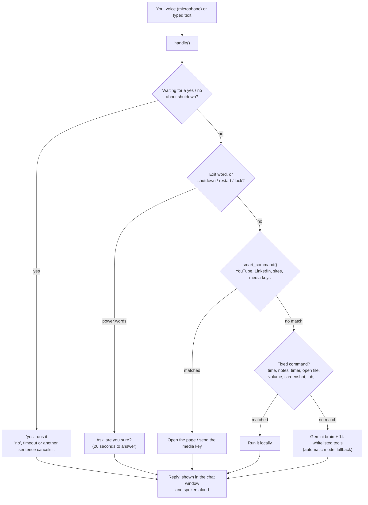

# Jarvis — Voice & Text Desktop Assistant for Windows

> A desktop assistant I built in Python that I can **talk to or type to**. It plays songs on YouTube, searches LinkedIn jobs, opens my files and apps, controls volume, and drafts job-application material from my own profile — and it asks for confirmation before anything risky such as shutting down my laptop.


---

## Table of contents

1. [Why I built it](#why-i-built-it)
2. [What it can do](#what-it-can-do)
3. [Example commands](#example-commands)
4. [How it works](#how-it-works)
5. [Design decisions and why](#design-decisions-and-why)
6. [Tech stack](#tech-stack)
7. [Installation](#installation)
8. [Using it](#using-it)
9. [Configuration](#configuration)
10. [Project structure](#project-structure)
11. [Testing](#testing)
12. [Problems I hit and how they were solved](#problems-i-hit-and-how-they-were-solved)
13. [Security and privacy](#security-and-privacy)
14. [Known limitations](#known-limitations)
15. [Roadmap](#roadmap)
16. [How this project was built](#how-this-project-was-built)
17. [License](#license)

---

## Why I built it

I am a third-year AI engineering student working towards a career as an AI engineer. I wanted one project that goes beyond notebooks and exercises: something I would actually use every day, that touches **LLM APIs, speech, desktop automation and safe system control** in one place.

The idea was a "Jarvis"-style assistant, inspired by the fictional assistant from the Iron Man films, with these goals:

- Work by **voice and by text**.
- **Know my background**, so it can help with job applications without inventing facts.
- Do the boring navigation for me: *"open YouTube and play this song"*, *"go on LinkedIn and search AI jobs in Germany"*. I do the applying myself; Jarvis only gets me to the right page.
- **Control my laptop** — open files and apps, change volume, take screenshots.
- Run like **normal desktop software** (a desktop icon and a window), not a script I start from a code editor.
- Keep working when the AI service is busy or down.

## What it can do

| Area | What it does |
|---|---|
| **Voice and text** | Hands-free listening (stops recording when you stop talking), spoken replies, a chat window, command history with the Up arrow |
| **YouTube** | Finds the first real video for a song or title and opens it so it starts playing; pause / resume / next / previous |
| **LinkedIn and job sites** | Builds a LinkedIn **jobs** search with keywords, location and remote filter; also Indeed, Upwork, Fiverr, GitHub, DAAD, Wikipedia, Stack Overflow, Maps, Scholar, Gmail |
| **PC control** | Open websites, apps, and **files or folders by name**; volume up/down/mute; screenshots; notes; timers |
| **Power control** | Lock, restart and shutdown — **always ask "are you sure?" first**, with a 15-second window to cancel a shutdown |
| **AI brain (Gemini)** | Answers questions and writes drafts using my profile; can call 14 whitelisted tools; automatically falls back between models and times out instead of freezing |
| **Memory** | Remembers facts I tell it and the recent conversation between sessions; refuses to store passwords or card numbers |
| **Job helper** | I paste a job description; it writes an honest **fit summary (including gaps)**, a **cover letter**, **likely interview questions** and **what to add to my profile** |
| **Diagnostics** | `mic test` and `status` commands show what is working, and why something is not |

## Example commands

Said by voice or typed — both work the same way.

```text
open youtube and search tum hi ho and play it
play believer
pause            next song            previous song
go on linkedin and search machine learning engineer jobs in germany
search remote python developer jobs on linkedin
search ml engineer on indeed
open gmail               open notepad              open my cv
volume up                screenshot                timer 10
remind me in 10 minutes to submit the form
shutdown                 (asks first; say "yes" to confirm, "cancel shutdown" to stop)
write a short email asking for a scholarship deadline extension
job                      (analyses the job description saved in job.txt)
mic test                 status                    help
```

It understands filler and common mishearings: *"can you please open you tube and play kesariya"* works.

## How it works



**The key idea: the AI is the last resort, not the first.** Anything Jarvis can understand with simple, reliable rules is handled locally, instantly, and without internet access to an AI service. Only open-ended requests (write an email, explain a concept) go to Gemini.

### Threads and queues

A desktop window freezes if slow work (speech, network, recording) runs inside it. Jarvis keeps the window responsive with background threads that communicate through queues:

| Thread | Job |
|---|---|
| **Main thread** | Draws the Tkinter window and, every 100 ms, reads `ui_queue` for new chat messages and status changes |
| **Command worker** | Takes one command at a time from `cmd_queue` and runs `handle()` |
| **Speaker worker** | Takes sentences from `speaker_queue` and speaks them (own thread, because speech blocks) |
| **Listener** | In hands-free mode, records and recognises speech, then puts the text in `cmd_queue` |
| **Boot thread** | Loads memory and settings and connects to Gemini, so the window opens instantly |

### Voice input in detail

1. Audio is read from the microphone in 0.2-second blocks (16 kHz, mono) using `sounddevice`.
2. The loudness (RMS) of the first three blocks is measured to learn the room's background level.
3. The "this is speech" threshold is `min(max(120, 3 × background), 700)` — it adapts to quiet microphones and noisy rooms.
4. Recording starts when a block is louder than the threshold and stops after **1.3 seconds of quiet** (or 25 seconds maximum).
5. The audio is sent to Google's web speech recogniser through the `SpeechRecognition` library and returned as text.

## Design decisions and why

| Decision | Why |
|---|---|
| **Local command parser before the AI** | An early version sent everything to the AI. Requests like "open YouTube and play this song" failed, because the AI only had a "search" tool and sometimes the service was unavailable. Handling common intents with regular expressions made them instant and reliable, even when the AI is down. |
| **AI can only use a fixed list of tools** | The model can open sites, search, play media, open allowed apps, change volume, take screenshots, and manage notes and timers — and nothing else. It has **no shutdown/restart/lock tool at all**; those exist only in code that requires my spoken or typed "yes". |
| **Confirmation + grace period for power actions** | A misheard word must not turn my laptop off. Power words are only recognised in short sentences, need confirmation within 20 seconds, and shutdown/restart wait 15 seconds so they can be cancelled. |
| **Blocklists for programs and file types** | Jarvis will not open command prompt, PowerShell, registry editor and similar, nor `.exe`, `.bat`, `.ps1`, `.vbs` and other runnable file types, even by name. |
| **Job description treated as untrusted data** | Job postings are text from strangers. While analysing one, the AI is told never to follow instructions inside it and is given **no tools**, so a malicious posting cannot make it open or do anything. |
| **Never invent experience** | The AI is instructed to use only facts from my profile. In the job helper it writes `[ADD: what is needed]` where information is missing instead of making things up; in normal chat it asks me. |
| **I do the applying** | Jarvis opens the right job-search page. It never logs in, types passwords, or clicks Apply. |
| **Model discovery + fallback + timeouts** | Model names change and services get busy. Jarvis asks Google which Flash models my key can use, tries them in order, skips a failing one immediately, and gives up on a request after 15 seconds instead of hanging. |
| **Adaptive microphone threshold** | A fixed sensitivity ignores quiet microphones. Measuring the room first works on more hardware. |
| **Hands-free on by default, with `mic test` and `status`** | If voice does not work, the user should be told why on screen, not left guessing. |
| **Launcher without a console** | The desktop shortcut runs with `pythonw`, so it opens like normal software: no black window and no code editor. |

## Tech stack

| Part | Technology |
|---|---|
| Language | Python 3.9+ |
| Window | Tkinter (dark theme, status light, quick-action buttons) |
| AI | Google Gemini API via the `google-genai` SDK (function calling, system instructions, model fallback) |
| Speech to text | `SpeechRecognition` (Google web recogniser) + `sounddevice` + `numpy` for recording |
| Text to speech | `pyttsx3` (Windows built-in voices, works offline) |
| Understanding commands | Regular expressions (`re`) |
| System control | `os.startfile`, `subprocess`, PowerShell (volume keys, screenshots), Windows `shutdown` command |
| Concurrency | `threading`, `queue` |
| Data | JSON (`memory.json`, `settings.json`), plain text notes and logs |
| Packaging | `install_jarvis.py` creates Desktop and Start-menu shortcuts that run with `pythonw` |
| Testing | Plain Python scripts with fakes for the microphone, speech engine and Gemini server |

## Installation

### What you need

- Windows 10 or 11
- Python 3.9 or newer from [python.org](https://www.python.org/downloads/) — during installation tick **"Add Python to PATH"** and keep **"tcl/tk and IDLE"** ticked
- A microphone (optional — typing works without one)
- A free Gemini API key from [Google AI Studio](https://aistudio.google.com/apikey) (free-tier availability depends on your region and can change)

### Steps

1. **Download** this repository (green **Code** button → **Download ZIP**) and extract it, or `git clone` it.
2. **Create your key file.** Copy `api_key.example.txt` to `api_key.txt` and replace the placeholder with your key. The file must contain only the key.
3. **Create your profile.** Copy `profile.example.txt` to `profile.txt` and fill in **your real** skills, projects and goals. The assistant uses only what is written here when it drafts job material.
4. **Double-click `Install Jarvis.bat`.** It installs the libraries, puts a **Jarvis** icon on your Desktop and in the Start menu, and asks whether to start with Windows.
5. **Open Jarvis from the Desktop icon.** A window opens, shows a status report (voice, microphone, AI brain), and starts listening.

Manual alternative:

```bash
pip install -r requirements.txt
python jarvis.py            # window
python jarvis.py --text     # terminal mode
```

> Never upload or share `api_key.txt`. See [Security and privacy](#security-and-privacy).

## Using it

- **Talk:** hands-free listening is on by default. The status light turns red and says *Listening…* while it waits for you. Untick **Hands-free listening** to stop; the choice is remembered.
- **Type:** use the box at the bottom and press Enter. Up/Down arrows bring back earlier commands.
- **Buttons:** Job helper, Notes, Screenshot, Outputs, Mic test, Status, Help, Clear chat.
- **Job helper:** type `job`, paste the job description into the `job.txt` file that opens, save it, then type `job` again. The result is saved in `outputs/` and opened. **Read every line before you send anything**, and fill in every `[ADD: …]` yourself.
- **If it does not hear you:** type `mic test`. It tells you which microphone it uses and whether it hears you, and where to raise the input volume in Windows.
- **If something breaks:** type `status`, and read the last lines of `jarvis.log`.

## Configuration

Settings are constants at the top of `jarvis.py`:

| Constant | Meaning |
|---|---|
| `MODEL_NAME` | First Gemini model to try (others are discovered automatically) |
| `FAST_TIMEOUT_MS` / `LONG_TIMEOUT_MS` | Time to wait for normal answers (15 s) and job analysis (90 s) |
| `AUTO_LISTEN` | Start hands-free listening when the app opens |
| `MIN_VOICE_LEVEL` | Quietest sound counted as speech (lower = more sensitive) |
| `POWER_GRACE_SECONDS` / `CONFIRM_SECONDS` | Cancel window for shutdown (15 s) / time to say "yes" (20 s) |
| `EXTRA_FOLDERS` | Extra folders searched by "open file <name>" (Desktop, Documents, Downloads are always searched) |
| `SITES`, `SITE_SEARCH`, `APPS` | Websites, site-search templates and apps Jarvis knows |
| `BLOCKED_APPS`, `BLOCKED_EXT` | Programs and file types Jarvis will never open |

The user's name ("Mehr") appears in the greeting and AI instructions; search and replace it in `jarvis.py` to personalise.

## Project structure

```text
jarvis-desktop-assistant/
├── jarvis.py                 # the whole application (see docs/CODE_TOUR.md)
├── install_jarvis.py         # installs libraries, creates Desktop/Start-menu shortcuts
├── Install Jarvis.bat        # double-click launcher for the installer
├── jarvis.ico                # app icon
├── requirements.txt
├── api_key.example.txt       # copy to api_key.txt and add your key (never committed)
├── profile.example.txt       # copy to profile.txt and fill in (never committed)
├── .gitignore
├── LICENSE
├── docs/
│   ├── CODE_TOUR.md          # section-by-section explanation of jarvis.py
│   ├── DEVELOPMENT_LOG.md    # what I did, step by step, including every bug
│   └── screenshot.png
└── tests/
    ├── support.py            # runs tests on a temporary copy of jarvis.py
    ├── run_all.py            # runs everything and prints a summary
    ├── test_smart_commands.py
    ├── test_pc_controls_and_ai_tools.py
    └── test_voice_and_microphone.py
```

Files Jarvis creates while running (all ignored by git): `memory.json`, `notes.txt`, `job.txt`, `settings.json`, `jarvis.log`, `outputs/`.

For a guided explanation of the code, read **[docs/CODE_TOUR.md](docs/CODE_TOUR.md)**.

## Testing

```bash
pip install numpy SpeechRecognition google-genai
python tests/run_all.py
```

**146 automated checks in 3 files.** No microphone, speakers or API key are needed, because hardware and online services are replaced by fakes:

| File | Checks | What it proves |
|---|---|---|
| `test_smart_commands.py` | 77 | YouTube play and search in many phrasings, LinkedIn job-URL building (keywords, location, remote), other sites, media keys, sentences that must **not** be hijacked, reading YouTube result pages, behaviour when the network fails |
| `test_pc_controls_and_ai_tools.py` | 38 | File/folder search and opening, blocked programs and file types, every shutdown/restart/lock confirmation path, volume keys, that a **fake Gemini server** receives all 14 tools and that a tool call opens the right file, job description handled as untrusted data without tools, graceful failure when the AI is unreachable |
| `test_voice_and_microphone.py` | 31 | Quiet microphone, noisy room, silence, speaking immediately, long speech cut-off, reasons for "heard nothing", mic-test verdicts, hands-free end to end, defaults at start-up, saved settings, clear messages when voice libraries are missing |

A static check with `pyflakes` also reports no problems.

**What the automated tests do not cover** (be aware of this): the real Gemini service, the real YouTube and LinkedIn websites, a real microphone and speakers, and Windows-only features (volume keys, screenshots, power commands, shortcuts) — those use simulated calls in the tests and were checked by hand on my laptop.

**Checked by hand on my Windows laptop:** installing with `Install Jarvis.bat`; opening Jarvis from the Desktop icon; hearing my voice commands; spoken replies; typed commands that open the browser.

## Problems I hit and how they were solved

Real errors from building this project. The full story is in [docs/DEVELOPMENT_LOG.md](docs/DEVELOPMENT_LOG.md).

| Symptom | Cause | Fix |
|---|---|---|
| `Failed building wheel for pyaudio` | `pip` tried to build PyAudio from source, which needs a C compiler that my laptop did not have | Replaced it with `sounddevice` + `numpy` and passed the recording to `SpeechRecognition` as raw audio |
| `Cannot send a request, as the client has been closed` | The Gemini client was a local variable and was cleaned up when the function ended | Kept the client in a module-level variable |
| `404 NOT_FOUND … model is no longer available to new users` | The hard-coded model name had been retired | Ask Google for the list of available Flash models at start-up and use the newest, with the rest as fallbacks |
| `503 UNAVAILABLE … high demand` | Google's servers were overloaded | Skip immediately to the next model instead of waiting; remember which model worked |
| App stuck on "Thinking…" forever | No time limit on the network request | Added request timeouts (15 s normal, 90 s for job analysis) |
| "Open YouTube and play this song" → *"I can't"* | Such sentences went to the AI, which only had a *search* tool, and the AI service was sometimes busy | Added a local command parser (regular expressions) plus a YouTube first-result lookup, so these work instantly and without the AI |
| Jarvis said "online" but never reacted to my voice | Hands-free was off by default in the window, and a fixed sensitivity limit ignored my quieter microphone | Hands-free on by default; adaptive microphone threshold; `mic test`, `status` and a start-up report that explains what is missing |
| Needed VS Code every time | It was a script | Added a Tkinter window, an installer, an icon and a Desktop shortcut that runs without a console |

## Security and privacy

- **API key:** keep it only in `api_key.txt`, which is in `.gitignore`. If a key is ever pasted into a chat, an issue or a commit, treat it as exposed: delete it at [aistudio.google.com/apikey](https://aistudio.google.com/apikey) and create a new one.
- **Your data leaves your computer in two ways:** anything that reaches the AI brain (open-ended requests and the job helper, including the contents of `profile.txt` and `job.txt`) goes to Google's Gemini API — the free tier may use prompts to improve Google products — and voice recordings are sent to Google's web speech recogniser. Local commands such as opening a site or setting a timer do not call the AI. Do not put passwords, ID numbers or private documents in `profile.txt`, notes or `job.txt`.
- **Local files:** `memory.json` (facts and recent conversation) and `notes.txt` are stored as plain text next to the program.
- **Safety rules in code:** power actions need confirmation; programs and runnable file types are blocked; the AI has a fixed tool list with no power tools; `remember` refuses text containing words such as password, card number or secret, or long digit sequences; job descriptions are treated as untrusted.
- **What Jarvis never does:** log in to websites, type passwords, click "Apply", or submit anything for me.

## Known limitations

- **Windows only** for volume keys, screenshots, power commands, opening files and the installer. The core logic runs elsewhere (that is how the tests run), but the product is built for Windows.
- **YouTube auto-play depends on reading YouTube's result page.** If YouTube changes its page, Jarvis falls back to opening the results and tells you to click the first video. Browsers may also block autoplay.
- **LinkedIn only shows results if you are signed in** in your browser, and LinkedIn can change its search URLs.
- **No wake word** ("Hey Jarvis"): in hands-free mode it reacts to any speech it hears, so do not leave it on near a TV or during video calls.
- **Voice recognition needs internet** and works best in a quiet room.
- **The AI service can be busy** or limited on the free tier; local commands keep working when it is.
- **`open <name>` opens the best match without asking**, so it can pick the wrong file when several have similar names (other matches are listed in the chat).
- **The automated tests use fakes**; real services are only verified by hand (see [Testing](#testing)).
- **Not packaged as a single `.exe`** yet; it needs Python installed.

## Roadmap

Ideas, not promises:

- Wake word ("Hey Jarvis") so it only reacts when addressed
- Settings for the user's name and language instead of editing the file
- Package as a single Windows `.exe` with PyInstaller
- Urdu and German voice input and replies
- Calendar and e-mail integration through official APIs
- Convert the test scripts to `pytest` and run them in GitHub Actions
- Ask before opening when several files match a name

## How this project was built

I built this over a few days in October 2026 while learning, working with **Claude (Anthropic) as an AI pair-programmer**. I want to be clear about the split, because it matters:

- **What I did:** defined the goal and every requirement (voice + text, desktop-app feel, YouTube and LinkedIn navigation, I do the applying myself, no VS Code), set it up on my own Windows laptop, ran every version, reported each real error message, tested the fixes, and decided what to keep.
- **What the AI did:** wrote and revised the code and tests, and explained errors, based on the results I reported.

The repository documents the whole path — including the failures — in [docs/DEVELOPMENT_LOG.md](docs/DEVELOPMENT_LOG.md), and explains the code in [docs/CODE_TOUR.md](docs/CODE_TOUR.md).

## License

MIT — see [LICENSE](LICENSE).
